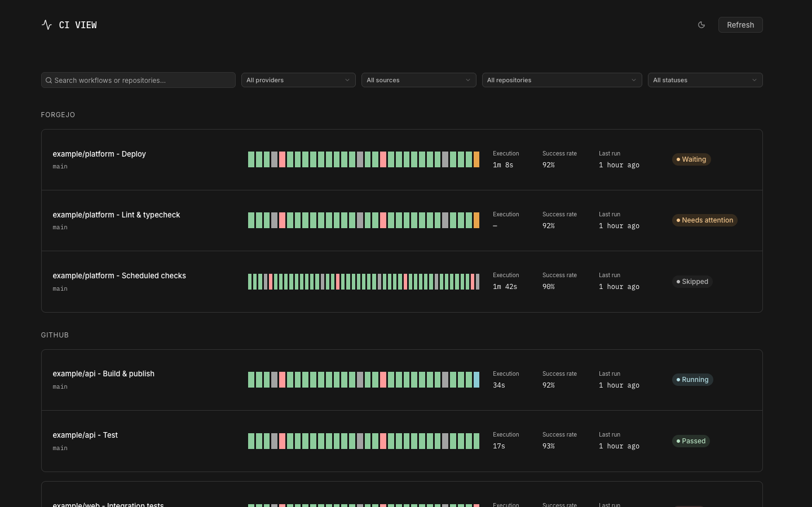

# CI View

Read-only GitHub Actions and Forgejo Actions viewer. Browse workflows, recent
runs, timing, and status across repositories, accounts, and organizations.

<!-- Add a screenshot at docs/screenshots/homepage.png. -->


## Installation

### Docker

Copy [ciview.example.toml](ciview.example.toml) to `ciview.toml` and edit your
sources, then run:

```zsh
docker run -d --name ciview \
  -p 127.0.0.1:8080:8080 \
  -v "${PWD}/ciview.toml:/app/ciview.toml:ro" \
  ghcr.io/danielfrg/ciview:latest
```

Open [http://localhost:8080](http://localhost:8080). The container runs as
UID/GID 65532; mounted configuration and token files must be readable by that user.
Pass referenced token environment variables with `-e`, or mount token files
read-only at the paths in the configuration.

### Standalone

Build from source using the [build instructions](#build), then run:

```zsh
cp ciview.example.toml ciview.toml
./ciview
```

Open [http://127.0.0.1:8080](http://127.0.0.1:8080).

## Usage

Search and filter by provider, source, repository, or latest status. Filters
survive reloads and browser navigation. Workflow titles open provider history;
run bars and status links open the exact run. Hover or focus a bar for details.
Refresh reloads the cached overview; the server schedules upstream collection.

Provider failures retain useful rows and identify stale or incomplete data.
Source notices explain collection issues. CI View does not trigger or cancel runs.
API documentation is at `/api/docs`.

## Configuration

Configuration is done via TOML files.

```toml
# Public GitHub access works without credentials. Copy to ciview.toml to run.
[viewer]
refresh_interval = "10m"
discovery_interval = "10m"
history_runs = 30
history_pages = 5
branch = "default"

[[sources]]
name = "github"
provider = "github"
# Set true to hide workflows whose files no longer exist on the selected branch.
existing_workflows_only = false
# Generated Dependabot update and dependency-graph workflows are hidden by default.
show_dependabot_updates = false
repos = ["actions/checkout"]

# For private repositories or a higher GitHub API allowance, add one credential:
# token_env = "CIVIEW_GITHUB_TOKEN"
# token_file = "/run/secrets/github-token"
# orgs = ["example-org"]
# users = ["example-user"]
# repos = ["example-owner/example-private-repository"]

# Add named Forgejo instances as separate sources. base_url is the instance root.
# [[sources]]
# name = "forgejo"
# provider = "forgejo"
# existing_workflows_only = false
# base_url = "https://forgejo.example.net"
# token_env = "CIVIEW_FORGEJO_TOKEN"
# orgs = ["example-org"]
# users = ["example-user"]
# repos = ["example-owner/example-repository"]
```

`branch = "default"` uses each repository's default branch (usually `main`).
A named branch such as `branch = "release"` uses that branch instead.

Forgejo rows use the selected branch’s workflow `name:` when it is available.
Missing or unreadable titles fall back to the workflow filename. All-branch
views keep the names supplied by the provider.

Sources include historical workflows by default, even when their files have
been deleted. Rows show a **Not on branch** badge when a successful check confirms
that the workflow file is absent from the selected branch. Unverified file status
and all-branch views receive no removal badge. To hide those workflows for one
source, set this inside its `[[sources]]` block:

```toml
existing_workflows_only = true
```

The default is `false`. When enabled, only workflows whose files still exist
on the selected branch are shown; removed workflows disappear after the next
successful refresh. If branch contents cannot be read, previous rows remain
visible as stale data. This option has no effect with `branch = "all"`, which
keeps historical workflows across all branches. GitHub fine-grained tokens need
repository Contents read access in addition to Actions read access to verify
workflow files. Without Contents access, history remains available when this
option is disabled, with a file-status notice.

GitHub-generated Dependabot update and dependency-graph workflows are hidden
by default. To include them for a source, add this to its `[[sources]]` block:

```toml
show_dependabot_updates = true
```

The default is `false`, including with `branch = "all"`. This matches GitHub's
`dynamic/dependabot/` workflow paths; regular CI workflows triggered by Dependabot
pull requests remain visible within the configured branch scope. The
`existing_workflows_only` filter still applies when enabled, so leave it `false`
to include generated workflows in named/default branch views.

Forgejo token requires:

- Repository → Read (read:repository)
- User → Read (read:user)
- Organization → Read (read:organization)

`CIVIEW_CONFIG` selects the TOML file (default `ciview.toml`). `CIVIEW_ADDR`
selects the listen address (default `127.0.0.1:8080`). `CIVIEW_API_TARGET`
overrides the development proxy target (default `http://127.0.0.1:8080`).
Credential references are resolved on the server; tokens never reach the browser.
GitHub fine-grained tokens need Actions read access, plus Contents read access
for workflow-file verification. Configure credentials only when needed.

Liveness is `/healthz`; readiness is `/readyz`. Both check the running HTTP
service without depending on provider availability, so upstream outages do not
remove access to cached data.

### MCP

The native Streamable HTTP endpoint is `/mcp`. Tools: `list_workflows`, `get_workflow`, `list_runs`, `get_source_status`.
All tools read cached state without triggering upstream collection. History may be partial; results preserve exact outcomes, nullable timing, source issues, and freshness. No run triggering, cancellation, or logs are exposed.

List tools accept `limit` (default 20, maximum 100) and nonnegative `offset`,
returning `total` and nullable `next_offset`. Responses are structured JSON.
Connect a remote MCP client using its Streamable HTTP transport, for example:

```json
{"url": "http://127.0.0.1:8080/mcp", "transport": "streamable-http"}
```

MCP accepts localhost by default. For a proxy or container network, set
`CIVIEW_MCP_ALLOWED_HOSTS` to a comma-separated list of exact hostnames
or IP addresses, such as `app.example.net,app.default.svc.cluster.local`.
Do not include schemes, ports, or wildcards. Invalid values fail startup.
Browser origins must match the request host and port. Requests use POST with a
1 MiB body limit; responses use `Cache-Control: no-store`. The endpoint has no
built-in authentication: use a trusted network or an authenticated proxy.

## Development

Requires Go 1.25, Node 26, pnpm 10, and just.

```zsh
just install
cp ciview.example.toml ciview.toml
just api
```

In another terminal:

```zsh
just frontend
```

Open [http://127.0.0.1:5173](http://127.0.0.1:5173). Vite proxies API
requests to the Go server. Run `just check` for Go race tests, vet, frontend
tests, and Svelte/TypeScript checks.

The repositories share this structure:

```text
cmd/<app>/              Configuration and server lifecycle
internal/               Go application packages
internal/httpapi/       HTTP API and health probes
internal/web/           Embedded frontend and static serving
frontend/src/theme.css  Shared palette, typography, and font definitions
frontend/src/app.css    Application layouts and interactions
scripts/                Container smoke test
docs/screenshots/       README screenshots
```

The shared theme loads Inter and IBM Plex Mono from Google Fonts, with dark, light,
and system preferences. Dark is the default; the header theme control saves
your choice. Keep `frontend/src/theme.css` identical across these projects.
`PRODUCT.md` describes users and purpose; `DESIGN.md` records interface rules.
Local plans, agent reports, and design-tool state stay out of Git.

## Build

```zsh
just build
```

The executable embeds the built frontend and needs no Node runtime. Build and
smoke-test a local container with:

```zsh
just image-check
```

Published images support Linux AMD64 and ARM64. `latest` tracks `main`;
`sha-<commit>` tags and image digests can pin a deployment.
